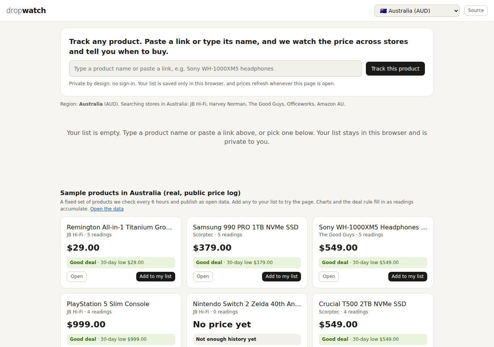
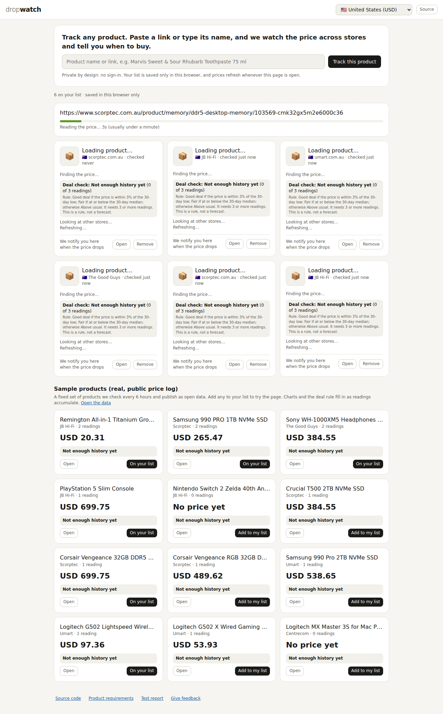
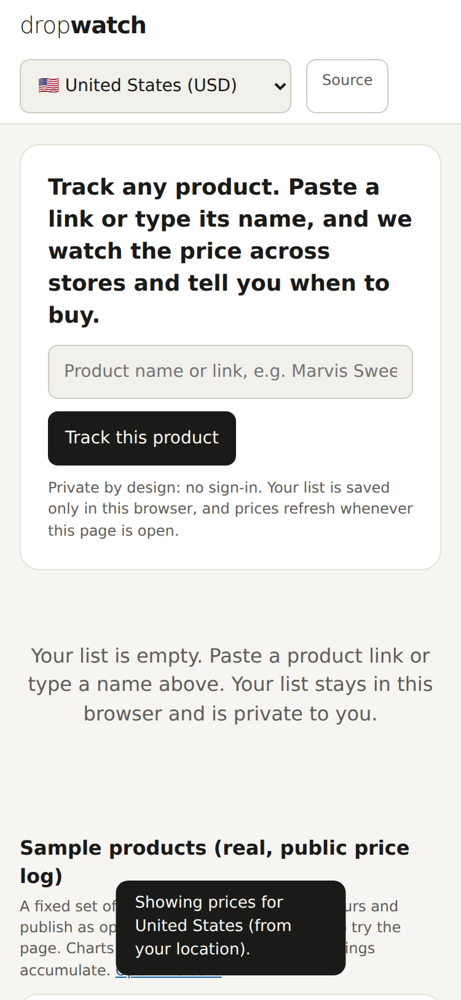

# DropWatch

A no-sign-in price tracker for Australian online shoppers. Paste a product link or type its name. DropWatch reads the price, shows a chart, compares a few established retailers, and says **buy now** or **wait**, with the rule written on the card.

Live: https://smtakbar.github.io/dropwatch/





*Screenshots are produced by the automated test run against the live site.*

## What it is, and is not
- It is a small, honest, open-data demonstration. It does not match the coverage of Google Shopping, Keepa or PriceSpy (see `PRD.md` section 8).
- It is **browser-only**. There is no database and no accounts. Your list is saved in your own browser (`localStorage`). Another person, device or browser starts empty.
- It cannot notify you while the page is closed. Browser notifications fire only when the page is open.

## Architecture
```
Visitor's browser (docs/index.html + docs/engine.js)
  - reads product pages through public read-only relays (first one that answers)
  - parses schema.org JSON-LD, meta tags and page data for price, image, stock
  - keeps the list and history in localStorage
  - computes the deal-check rule and the buy or wait advice
  - loads the public price log from data/ on GitHub

GitHub Actions
  - log-prices.yml  every 6 hours: fetches a fixed seed list (data/seed.json), appends data/prices.csv and data/fetch-log.csv
  - analysis.yml    daily: Monte Carlo script, writes data/analysis.json only for products with enough history
  - validate.yml    on test changes: Playwright end-to-end run, axe, Lighthouse on the live site, writes reports/
```
Key files: `docs/engine.js` (parsing, rule, advice), `scripts/log-prices.mjs` (logger), `analysis/monte-carlo.mjs`, `tests/e2e.mjs`.

## How the verdict works
- **Deal check (rule):** Good deal if today's price is within 3% of the 30-day low; Fair if at or below the 30-day median; otherwise Above usual. It needs 3 or more readings. It is a rule, not a forecast.
- **Buy or wait advice:** combines the deal rule, whether another trusted store is at least 5% cheaper, whether a usual sale month (November, December and January, July) is within two months, and stock status. Until about 60 days of history exist, the "likely low" figure is a seasonal estimate and is labelled as one.

## Regions
The region selector (13 countries) changes the whole page: currency and number format, the example text, the stores searched when you type a product name, and the sample products. Your list is filtered to the selected region, with a button to show items from other regions.
- **Sample products with a public price log** exist for Australia, India, Singapore, France, Brazil, South Korea and Japan. These are the regions where at least one retailer or price-comparison site allowed automated reads when tested on 5 Nov 2026. See `data/seed.json`.
- **United States, United Kingdom, Canada, Germany, New Zealand and UAE** have no logged sample products. The retailers tested (for example Newegg, Argos, MediaMarkt, PB Tech, Sharaf DG) refused automated requests, and I do not disguise the logger. Those regions show tap-to-search ideas instead, and your own history builds from your visits.
- Typed searches use the selected country's store allowlist. End-to-end price reads were tested on Australian retailers and on one Indian retailer. The other regions are tested for what the page shows, not for every store's price read. See `VALIDATION.md`.

## Stores that block automated reads
Some stores (for example Chemist Warehouse, tested 9 Nov 2026) show every automated request a Cloudflare bot check, including requests through the public relays. DropWatch detects that page, says so on the card, does not try to get around it, compares the same product at other stores, and lets you type the price you see. A pasted Google share link (share.google) only redirects, so the page asks for the store address or the product name instead.

## Exact matching and price protection
- **Barcode match.** When both pages publish a barcode (GTIN) or manufacturer part number in their product data, other-store offers are matched on that, not on the title. A different barcode rejects the offer, even if the titles look alike. Without identifiers on both sides, the strict title rule still applies. Offers matched by identifier are tagged "exact match".
- **"I bought this".** Enter what you paid, the date and your store's window (default 14 days). DropWatch watches the price and tells you if it falls 2% or more below what you paid while the window is open. Whether a store pays the difference depends on its own policy, which DropWatch does not know. The record stays in this browser.

## History from other trackers
Each card has a "Price history on other trackers" panel. It lists lookup links for trackers in that region (for example Buyhatke, PriceSpy, CamelCamelCamel, Kakaku, Danawa).
- **Read automatically:** pricehistory.app, for Indian products. DropWatch finds the matching page and imports its lowest, average and highest price, then applies a labelled rule to your current price. This is imported data, not measured by DropWatch.
- **Link only:** every other tracker. Buyhatke returns an access-denied response to automated requests and its `robots.txt` disallows its API paths, so I do not scrape it. CamelCamelCamel sits behind a bot check that the free relays cannot pass. The links open a search for the product on that tracker.
- Imported figures are summary numbers (low, average, high), not day-by-day series.

## Constraints and honest limits
- **Data reliability.** Many stores refuse automated requests. The logger identifies itself (`DropWatchResearchBot`), obeys `robots.txt`, makes one request per product per run, and records every outcome in `data/fetch-log.csv`. It does not disguise itself. The seed list only contains products from stores that allowed this.
- **Relays.** Browsers cannot read other sites directly, so pages go through free public relays. They can be slow or unavailable. Timings from the last test run are in `VALIDATION.md`.
- **Retailer allowlist.** Only established retailers are shown. A store missing from the per-country list in `docs/engine.js` is never shown.
- **Privacy.** No personal data is collected or stored by this project. The page asks an IP-location service which country you are in, only to pick your starting region. You can change it at any time.
- **Usage metrics.** None exist yet. See `PRD.md` section 6.
- **Machine learning.** Not built yet. It needs more history (`PRD.md` section 9).

## Data
`data/prices.csv` (timestamp, id, store, price, currency, in_stock) and `data/fetch-log.csv` are public. Prices belong to the retailers; the log is for research and demonstration.

## Run the tests
`node tests/country.mjs` checks store-country detection (a regression table that includes the zara.com/au and myntra.com cases). It runs on every change to `docs/engine.js`.

`validate.yml` runs on GitHub. To run locally: `npm i playwright-core axe-core lighthouse chrome-launcher`, then `node tests/e2e.mjs` and `node tests/lighthouse.mjs`.

## Documents
`PRD.md` (problem, decisions, metrics, roadmap, changelog), `VALIDATION.md` (test report), `BACKLOG.md` (prioritised work).

## Licence
No licence file has been added yet **[owner to choose]**.
